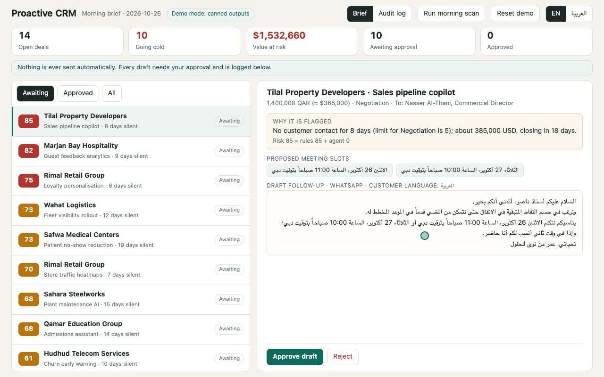
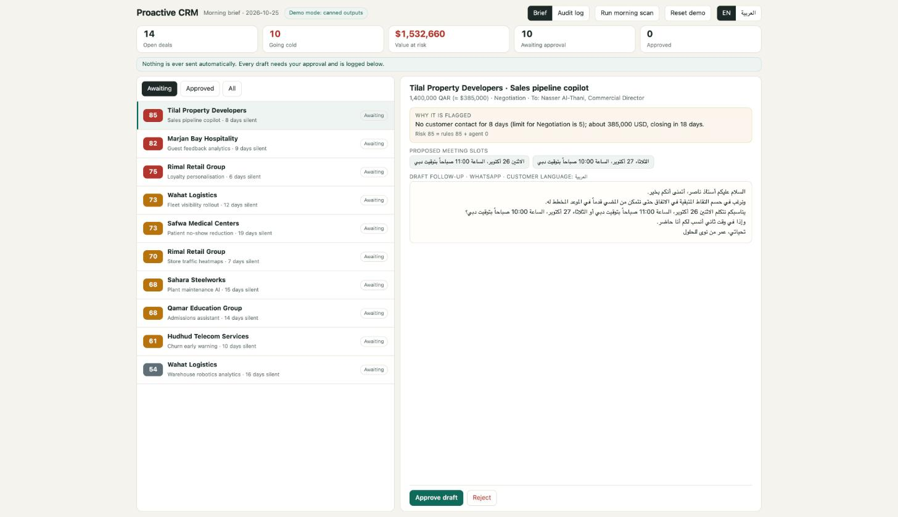
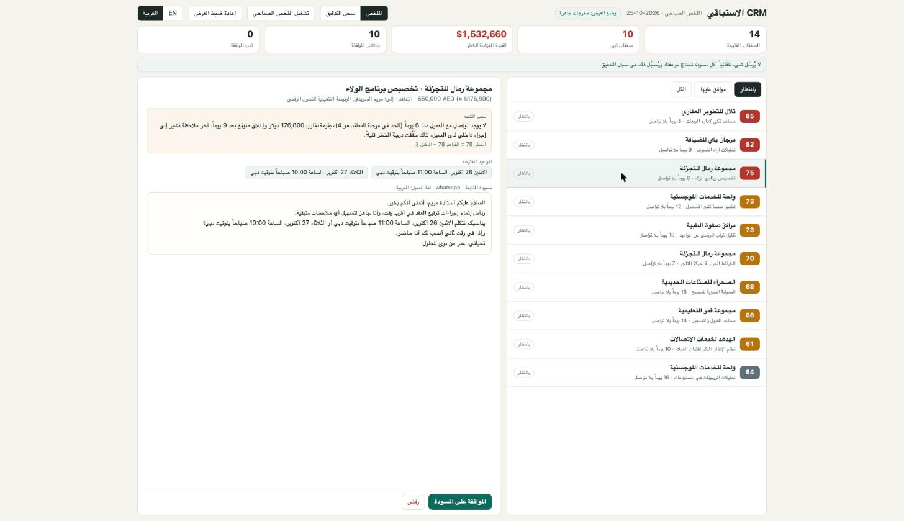
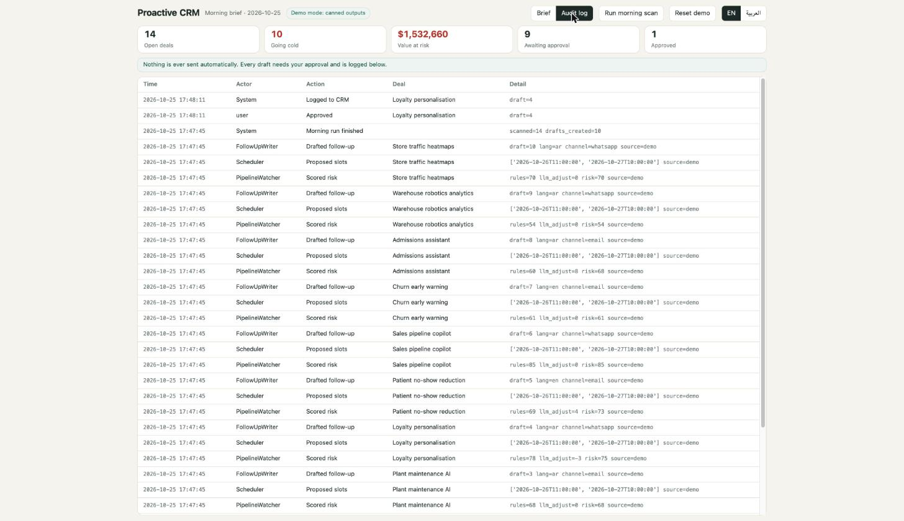
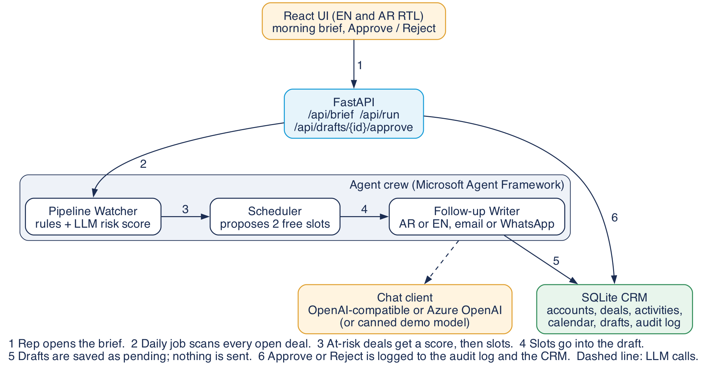

# Proactive CRM Agents

**No deal goes cold silently: agents watch the pipeline every morning, flag deals with no activity, draft a personalised follow-up in Arabic or English, propose a meeting slot and log everything back to the CRM, so sales teams recover revenue they were losing to silence.**

**Catch cold deals.**



[Silent MP4](proactive-crm/docs/demo.mp4) | [Poster frame](proactive-crm/docs/poster.png) | Recorded from the real UI in demo mode, nothing mocked.

> Built on Microsoft's [Agent Framework](https://github.com/microsoft/agent-framework) (MIT). My additions live in [`proactive-crm/`](proactive-crm/). The rest of this repository is the unmodified upstream code, kept for provenance. The upstream README is [UPSTREAM_README.md](UPSTREAM_README.md).

## What it does

Every morning the crew scans the pipeline. For each open deal that has gone quiet for longer than its stage allows:

1. **Pipeline Watcher** scores the risk: a deterministic rule score (days silent vs the stage limit, deal value, close date) plus a bounded LLM adjustment based on the last note.
2. **Scheduler** proposes two meeting slots from the rep's sample calendar, respecting Gulf working weeks (Mon to Fri for the UAE rep, Mon to Thu for customers in KSA, Kuwait and Qatar, and a Friday prayer window).
3. **Follow-up Writer** drafts the message in the customer's language (Gulf business tone Modern Standard Arabic, or English), as an email or a WhatsApp message, with the two slots in it.

A human approves or rejects every draft. Nothing is ever sent: there is no sending code. Approval logs a CRM activity, and every step lands in an audit log.

| Morning brief (English UI, Arabic draft) | Arabic UI (RTL) | Audit log |
|---|---|---|
|  |  |  |

## Architecture



The three agents are real `agent_framework.Agent` objects. In demo mode their chat client is a custom `BaseChatClient` that returns deterministic outputs; in live mode it is Agent Framework's `OpenAIChatCompletionClient`. If a live call fails or returns invalid output, the pipeline falls back to the deterministic template and records `source=fallback` in the audit log.

## Quickstart (no Azure, no API key)

```bash
cd proactive-crm
./run.sh            # creates a venv, installs, seeds the sample CRM, serves http://localhost:8000
```

Python 3.10+ is required. The first start seeds a fictional Gulf CRM and runs the morning scan. Use "Run morning scan" and "Reset demo" in the UI to replay it.

Optional live model (names only, set whichever you have):

| Env var | Effect |
|---|---|
| `OPENAI_API_KEY` (+ `OPENAI_BASE_URL`, `OPENAI_MODEL`) | Any OpenAI-compatible endpoint |
| `AZURE_OPENAI_ENDPOINT` + `AZURE_OPENAI_API_KEY` (+ `AZURE_OPENAI_MODEL`) | Azure OpenAI |
| `CRM_FORCE_DEMO=1` | Force the canned model even if keys are present |

Tests: `pip install -r requirements-dev.txt && pytest` (rules, slot logic, and the full approve flow through the API).

## Built on Microsoft's Agent Framework (MIT). My additions:

- **Three cooperating agents** (`proactive_crm/agents.py`): Pipeline Watcher, Scheduler, Follow-up Writer, with strict JSON contracts, bounded LLM influence and automatic fallback.
- **Gulf sample CRM** (`proactive_crm/db.py`): SQLite with accounts, contacts, deals, stages, activities, a calendar, drafts and an audit log. All 12 companies and all people are fictional; dates are relative to today so the demo never goes stale.
- **Human in the loop**: drafts start as `pending`, only an Approve or Reject click changes that, approval is single-use, and every action is audited.
- **Local demo mode**: one command, no cloud, deterministic Arabic and English drafts (`proactive_crm/canned.py`).
- **Bilingual web UI** (`proactive_crm/static/`): React 18 (vendored, no build step), English and Arabic with full RTL layout.
- **Gulf scheduling rules** (`proactive_crm/rules.py`): customer-country working weeks, Friday prayer window, Arabic date and time formatting.

## What runs locally and what needs Azure

- Runs locally, verified: the whole demo (data, three agents, approval flow, audit log, UI), the test suite, and the live-model code path against an OpenAI-compatible endpoint (checked with a local stub server, not with a paid key).
- Needs nothing from Azure. Azure OpenAI is supported through the env vars above but I have not run it against a real Azure resource.
- Not built: running the daily scan on a schedule in the cloud (for example an Azure Container Apps job or a cron entry calling `POST /api/run`), a real CRM connector (Dynamics 365, HubSpot, Salesforce), and actual sending of messages.

I first evaluated Microsoft's Multi-Agent Custom Automation Engine accelerator, but it requires provisioned Azure resources (Cosmos DB, an AI Foundry project) and has no local mode, so I chose the lighter Agent Framework as the base.

## Licence

MIT, see [LICENSE](LICENSE). Upstream copyright remains with Microsoft; my additions are released under the same licence. The sample data is fictional.
